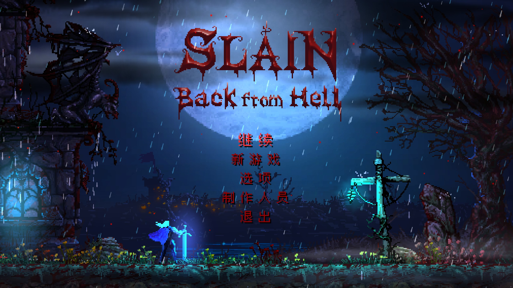
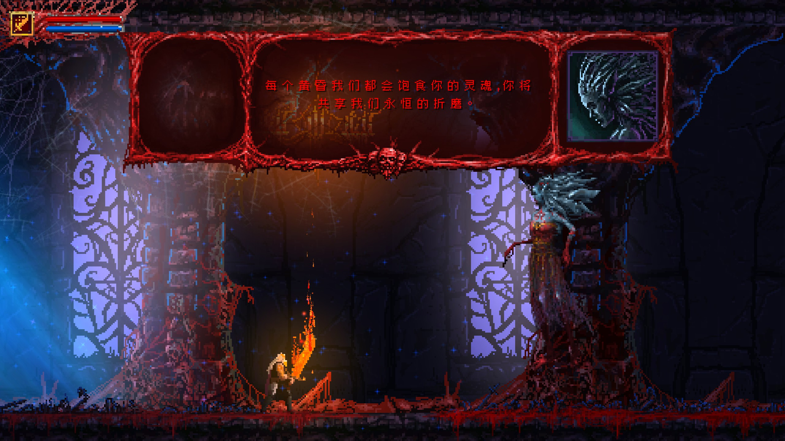
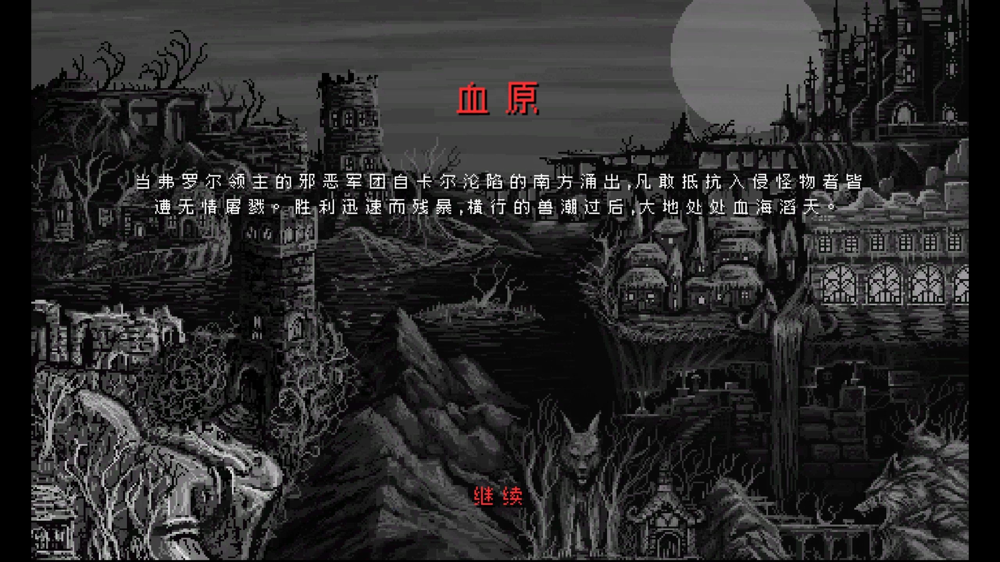

# Slain! 中文本地化补丁

把游戏的剧情对白、菜单、UI、操作提示、制作人员、成就等全部翻译成中文，并把游戏原本不支持中文的位图字体换成 Fusion 像素字体（开源 OFL），中文清晰显示，无乱码、无白屏。



## 一、最简单安装

1. 完全退出游戏。
2. 把压缩包解压到任意文件夹。
3. 双击 `INSTALL_CN.bat` —— 它会自动查找游戏目录（检查脚本所在位置、Steam 注册表、Steam 库清单），先备份原版文件，再安装中文补丁。
4. 看到 `[OK] Chinese patch installed.` 即成功，启动游戏即可。

如果自动查找失败（提示 Game folder not found），手动安装：

- 把 `Slain_Data\resources.assets` 复制到 `游戏目录\Slain_Data\resources.assets`（覆盖同名文件）。
- 游戏目录通常类似 `C:\Program Files (x86)\Steam\steamapps\common\Slain!`。

## 二、还原英文原版

双击 `RESTORE_EN.bat`：会先用安装时留下的 `resources.assets.orig_backup` 还原；若没有该备份，则用包内 `orig_backup\resources.assets` 还原。

也可手动把 `orig_backup\resources.assets` 复制到 `游戏目录\Slain_Data\resources.assets` 覆盖。

## 三、内容说明

| 项目 | 说明 |
|---|---|
| 汉化文本 | 443 条，等长回填（剧情对白、11 段序章、Boss 台词、菜单/UI/按键/教学/制作人员、成就） |
| 专名统一 | Bathoryn=巴托林，Vroll=弗罗尔，Chalh=卡尔，Hogre=霍格，Malikesh=马利凯什，Beholder=眼魔 |
| 中文字体 | Fusion Pixel Font 12px 简体中文版（SIL OFL 1.1，可商用），24px 整数倍渲染，硬边点阵 |
| 英文字体 | 保留游戏原版哥特字体，不改动 |
| 修改的文件 | 仅 `Slain_Data/resources.assets` 一个文件 |
| 不修改 | 游戏程序、DLL、其它资源均不改动；resS 文件不改动 |

## 四、兼容性 / 注意

- 适配 Steam 版 Slain!（32 位，Unity Mono）。汉化只改资源包，不影响存档，不影响成就解锁。
- 补丁与「血蓝锁定修改器」互相独立，可同时使用（修改器改的是 DLL，本补丁改的是 resources.assets）。
- 若游戏已装了其它 mod 改动过 `resources.assets`，安装会覆盖它；原版已备份，可随时还原。
- 若覆盖后进入游戏出现白屏/乱码，先用 `RESTORE_EN.bat` 还原，再确认是否装错了旧版补丁。

## 五、文件清单

解压后双击 `VERIFY_INTEGRITY.bat` 可校验文件是否完整：四个关键文件全部显示 `[OK]`、最后出现 `All files OK. Patch package is intact.` 即为完好。若传输中损坏会显示 `[FAIL]`/`[MISS]`，重新下载即可。哈希值记录在 `SHA256.txt`。
```
Slain!_中文补丁_覆盖版.zip
├─ INSTALL_CN.bat            一键安装（自动找游戏目录 + 备份 + 覆盖）
├─ RESTORE_EN.bat            一键还原英文原版
├─ VERIFY_INTEGRITY.bat      双击校验文件完整性
├─ SHA256.txt                四个关键文件的哈希清单
├─ 说明.md                   本文件
├─ Slain_Data/
│   └─ resources.assets      中文补丁文件（文本 + 缝合字体，字体已内嵌）
└─ orig_backup/
    └─ resources.assets      英文原版文件（供还原）
```

### 六、其他下载地址
度盘：/s/1GCB_7lSBiBn8n00iDTKHQw?pwd=ksps 提取码: ksps 
蓝奏：/iQE2U4gtg9je 密码:7iu6
